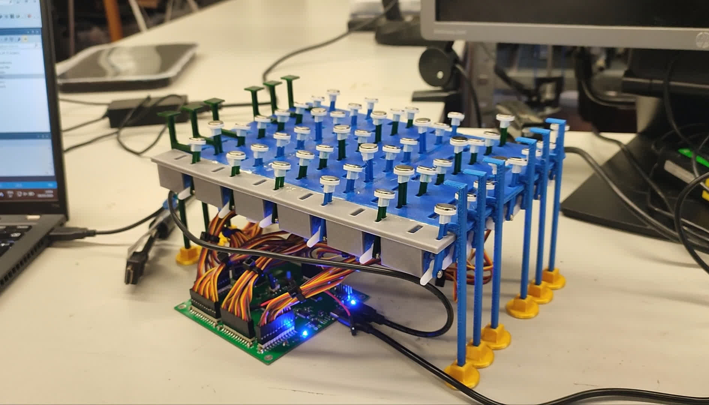
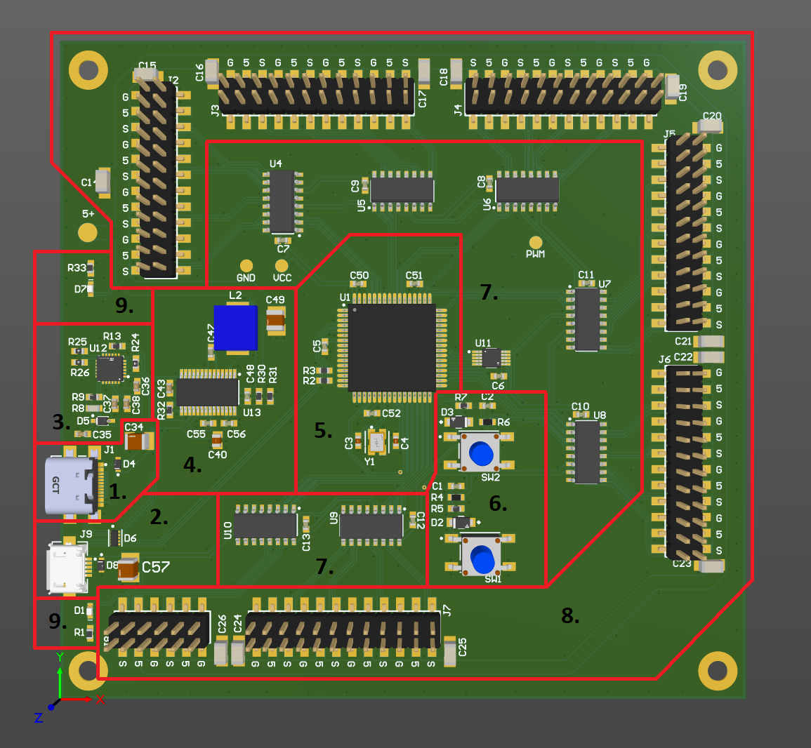
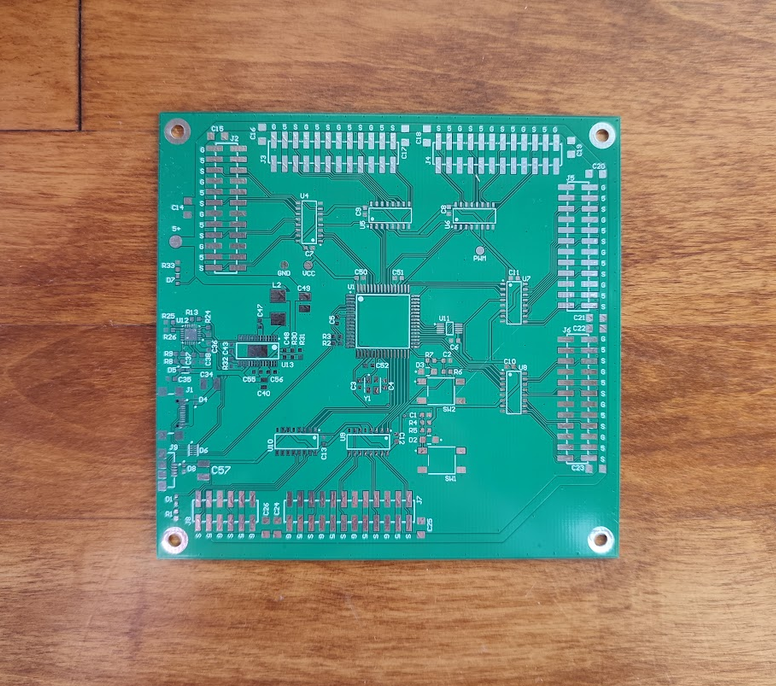
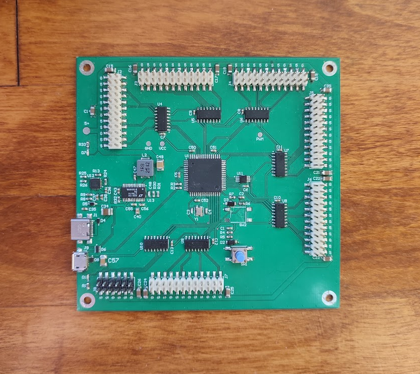

# Ferrofluid-Display

> ### State of the project: completed

This was a project I worked on with a partner as part of a university course.
This type of display uses ferrofluid and magnets to show symbols.
Usually people use a grid of electromagnets.
Because we had a limited budget but we still wanted to make a ferrofluid display, then we had to come up with a cheaper solution.
The goal of the magnets is to pull the ferrofluid close to the screen, which when done in a certain order, allows the fluid to be moved to the desired parts of the display. 
Instead of using electromagnets, we figured that we could use permanent magnets that we move closer and further away from the display using servos. 
In the end, this mechanism worked, but we struggled to find a good container for the ferrofluid.
The best one we found stained very quickly and couldn't handle the pressure exerted by the liquid ferrofluid solution when stood vertically.
While this project could be considered a failure, then I'm still proud of it and my partner and I received an A for this project.

[Video](https://youtu.be/KwNlmwMZApc) of the display.

### Sections of the PCB

The design schematic and PCB files can be found [here](https://github.com/k3idi/Ferrofluid-Display/tree/main/PCB%20design%20files).

#### 1. USB C

The USB C connector is used to supply power to the 48 (or up to 52) servos.
The reason why we put in two separate power supplies was to eliminate the chance of servos drawing current from the laptop.
That is because the laptop could supply up to 0.5 A, but the servos could have drawn over 1 A (in an abnormal situation, normally it was way under 0.5 A).
This circuit contains a USB C connector (J1), an ESD protection diode for the VBUS line (D4) and a decoupling capacitor on the VBUS line (C34).

#### 2. Micro B USB

This supplies all of the components except for servos. 
Also, the datalines are connected to the MCU's data pins, which allows us to programme the MCU thorugh the micro USB connector.
In this circuit, there is the connector (J9), ESD protection for the VCC line (D8), decoupling capacitor for the VCC line (C57) and ESD protection for the datalines as well as USB C's CC lines (D6).

#### 3. USB C Power Delivery Controller

By default, the USB C standard output for USB 2.0 is 500 mA at 5V. 
Since the servos could draw more than that, then we had to include a power delivery controller.
The component we chose (U12, STUSB4500) was by default set to negotiate 1 A at 20V, which was beyond sufficient for us.
We followed the typical application schematic from STUSB4500's [datasheet](https://datasheet4u.com/download/1363763/STUSB4500.html), while omitting the components that we wouldn't need for our application.

#### 4. Buck converter

Since the power delivery controller negoatiates 20V, but the servos need 5V, then we had to use a buck converter.
The circuit surrounding the buck converter was desgined using the thorough instructions and explanations given in its [datasheet](https://www.mouser.ee/datasheet/3/1014/1/8616fa.pdf).
The values of the feedback resistors (R30, R31) are what determined the output voltage of the buck converter.
In the end, we achieved an output voltage of ~5.1V.

#### 5. MCU

For the MCU, we chose Atmel's AT90USB647.
While this was a bit overkill for this project, then we had some reasoning behind our choice.
We knew that this project was going to be demanding and take up a lot of our time, so we wanted to make it as simple for ourselves as possible.
Due to this, we chose an MCU that we were already familiar with from another university course.
This circuit contains the MCU (U1), decoupling capacitors on the VCC line (C50-C52), decoupling capacitor for the USB's power regulator (C5), resistors on the datalines (R2, R3) and a 16 MHz crystal oscillator and its load capacitors (Y1, C3, C4).

#### 6. Buttons

We needed to include two buttons to reset the MCU and to be able to programme it.
SW1 was the RESET button and SW2 was the HWB button.
Both buttons have ESD protection diodes (D2, D3), voltage division and current limiting resistors (R4-R7) and anti-debounce capacitors (C1, C2).

#### 7. Demultiplexers and a multiplexer

Because we had 52 servo slots and a maximum of 41 free MCU pins, then we decided to use demultiplexers as a way to distribute the PWM signal to the servos.
Each demultiplexer could control up to 8 servos and we would need only 3 MCU pins to choose one servo.
This means that the total necessary MCU pin count falls from 52 to 21. 
We also added a multiplexer to switch between three different PWM signals that the demultiplexers would receive.
In this circuit, there are 7 total demultiplexers (U4-U1), one multiplexer (U11) and 8 decoupling capacitors (C6-C13).

#### 8. Servo Pinheaders

We ordered the absolute cheapest servos from Amazon since we were on a limited budget.
They worked pretty well, the only thing was that they somwhow flipped their PWM to angle mapping seemingly randomly. 
What I mean by this is that for example, if the servo's maximum movement range is from 0 degrees to 90 degrees, then at first a servo moved to a position of 30 degrees with a PWM duty cycle of 20%, but after some time passed, it instead moved to a 60 degree angle when receiving a PWM signal with a duty cycle of 20%.
We found that it happened more often when we skirted on the edge of the specified PWM duty cycle length.
Anyway, the servos came with a 2.54 mm pinheader connector, so we had to put a lot of pinheaders on the PCB. 
There is also 1 decoupling capacitor for every 4 servos (C14-C26).

#### 9. Power Indicator LEDs

These are LEDs that light up when a power supply is connected. 
The diode D7 lights up when USB C is connected and power delivery negotiation was successful (R33 limits the current through D7).
The diode D1 lights up when the micro USB cable is connected (R1 limits the current through D1). 

### Photos of the board

Unsoldered             |  Soldered
:-------------------------:|:-------------------------:
  |  

### Mistakes and fixes

##### Connecting CCBD to ground

Before this version of the board, we also had version 0. 
One mistake in version 0 that led to the development of version 1 (the one presented here) was connecting the CCDB pins of STUSB4500 to ground.
This was a mistake on my part, but I do have to say that in my opinion the section about the use of these pins in the datasheet could have been more clear.
Fisrt of all, DB in CCDB means dead battery, but we had not even a lick of a battery in our design. 
It was only said that "if dead battery mode is not used, then connect the pins to ground", and so I did.
However, that turned out to be a big mistake, because it turns out dead battery mode refers to a state when the STUSB4500 component has no power.
This was also the case for us, since it drew power from the USB C connector itself, which in return could not supply power before the power delivery negotiation was successful.
After trying out a hack where the CCDB pins were not grounded, the power delivery negotiation succeeded and thus we could implement this fix in version 1.

